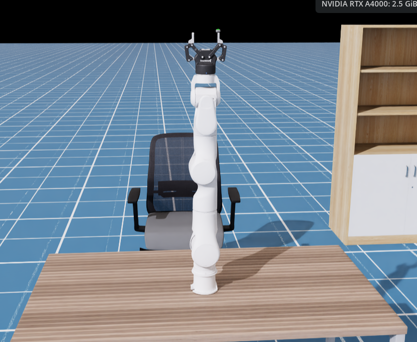
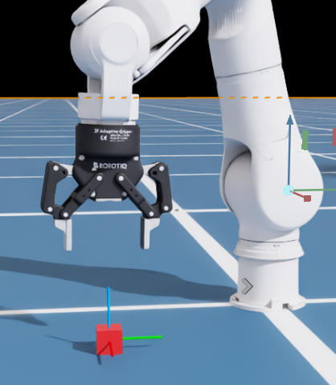

# Rokae AR5-5 + Robotiq 2F-85 —— Isaac Sim 差分 IK 路径规划

在 Isaac Sim 6.2.0 里驱动 7 自由度 Rokae 协作臂（`AR5_5_08L_W4C1C5`，末端装 Robotiq 2F-85 夹爪），
用**自研的差分逆运动学**做笛卡尔空间路径规划与顶抓演示。
IK 求解、轨迹插值、旋转误差全部手写 numpy，不依赖 Isaac Sim 自带的 Motion Planning / Lula 扩展。

| 场景全貌（`data/1.usd`）                                | 目标方块与 XYZ 轴标记（夹爪特写）                             |
| --------------------------------------------------------- | ------------------------------------------------------------- |
|  |  |

运动过程演示（99 s，自定义 IK 路径规划）：[docs/images/自定义实现路径规划.mp4](docs/images/自定义实现路径规划.mp4)

## 功能

- **差分 IK 四种解法**（[ik_solver.py](ik_solver.py)，`IKSolver.method` 可切）：
  `damped-least-squares`（默认，λ=0.05，奇异位形附近稳定）/ `pseudoinverse` / `transpose` / `singular-value-decomposition`（小奇异值截断）。
- **笛卡尔空间插值**（[pose_planner.py](pose_planner.py) 的 `follow_pose_path`）：
  位置走 `smoothstep5` 五次光滑插值（起终点速度与加速度均为零），姿态走四元数 `slerp`，每个插值点做一次 IK 闭环。
- **收敛判定**：位置 < 2.5 cm 且姿态 < 7°（`GraspConfig` 容差），settle 阶段满足即提前退出。
- **安全保护**：关节限位内缩 0.5° 裁剪、单步增益限幅（`IKConfig.step_gain`）、关节空间路径的单步最大变化限幅。
- **夹爪控制**（[robot.py](robot.py) 的 `GripperController`）：Robotiq 2F-85 的多个耦合 DOF（finger / knuckle）
  按命名自动分组正反方向；开合期间用 `arm_hold` 把臂关节目标锁住不动。
- **可视化目标**（[scene.py](scene.py) 的 `SceneManager`）：`/World/GraspTarget` 红色 kinematic 方块
  + `/World/TargetFrame` XYZ 轴标记；`set_target_pose()` 挪动方块后自检方块与轴标记的同步误差（>0.1 mm 直接抛错）。
- **接触传感器接口**：`actuate_gripper(..., contact_sensor=...)` 预留了 `ContactSensor` 传参（当前未启用）。
- **TCP 定义**：末端是法兰 link7（`AR5_5_08L_W4C1C5_link7`），不是手指中点 —— 早期版本用左右手指中点做 TCP，已改。

## 运行方式

代码以**包**形式组织（模块间相对导入），设计为在 Isaac Sim 运行时内导入使用；
目录里目前没有入口脚本（各模块 docstring 引用的 `app0.py` 不在本目录）。
`config.py` 与 `math_utils.py` 是纯 numpy，不依赖 isaacsim，可离线导入（已验证）。

按现有 API 整理的调用顺序（在 `python.bat` 启动的 Kit 环境 / Script Editor 里）：

```python
import sys; sys.path.insert(0, r"<仓库根>\my_tasks")

from isaacsim import SimulationApp
app = SimulationApp({"headless": False, "width": 1280, "height": 720})

# 打开 data/1.usd 场景后（usd_path 见 AppConfig）：
from isaacsim_rokae_arm.config import app_config
from isaacsim_rokae_arm.sim_app import SimulationManager
from isaacsim_rokae_arm.robot import RobotArm, GripperController
from isaacsim_rokae_arm.pose_planner import PoseIKPlanner
import numpy as np

sim = SimulationManager(app)          # Singleton，之后所有模块经 instance() 取用
robot = RobotArm(app_config.articulation_path)          # /arm/gripper/Robotiq_2F_85
planner = PoseIKPlanner(robot, GripperController(robot))
planner.set_home_pose_now()                              # 高位弯肘 home（瞬间跳转）

position, orientation = planner.get_pose()               # 读当前 TCP 位姿
planner.follow_pose_path(position + np.array([0, 0, -0.1]), orientation,
                        path_steps=240, settle_steps=360)  # 笛卡尔直线下降
planner.actuate_gripper(0.8203, steps=240)               # 夹爪闭合（0.0 = 张开）
planner.return_home(steps=240)
```

## 模块结构

```
isaacsim_rokae_arm/
├── config.py         # 全部可调参数（dataclass）+ home 关节角；纯 numpy，可离线导入
├── sim_app.py        # SimulationManager 单例：持有 SimulationApp，统一 update/close
├── math_utils.py     # 四元数运算 / RPY 转换 / 旋转误差 / slerp / smoothstep5；纯 numpy
├── ik_solver.py      # IKSolver：6D 误差 → 雅可比 → Δθ（四种解法）
├── robot.py          # RobotArm（关节读写/雅可比/限位）+ GripperController（耦合 DOF 开合）
├── scene.py          # SceneManager（目标方块 + XYZ 轴 + 相机）+ 臂体最低点计算（避障用）
├── pose_planner.py   # PoseIKPlanner：最上层接口，组合 IK + 插值 + 限位保护
├── joints.yaml       # 关节角草稿（度，手工调参记录，以 config.py 为准）
├── poses.yaml        # 位姿草稿
├── data/             # USD 资产与导入中间产物（见下）
└── docs/images/      # 截图与演示视频
```

调用链（`follow_pose_path` 为例，来自 [pose_planner.py](pose_planner.py) 顶部注释）：

```
follow_pose_path(goal_pos, goal_ori, path_steps, settle_steps)
  ├─ path_steps 次:
  │    phase = smoothstep5(step/steps)
  │    waypoint = lerp(start, goal, phase)         # 位置线性插值
  │    waypoint_ori = slerp(start, goal, phase)    # 姿态球面插值
  │    command_pose(waypoint)                      # 一次 IK 闭环：
  │        误差 → 雅可比(6×7) → DLS → Δθ → 增益/限位裁剪 → PD 目标
  └─ settle_steps 次:
       command_pose(goal)，位置+姿态误差双达标即提前收敛
```

## 关键参数（[config.py](config.py)）

| 配置                 | 关键字段                                                                  | 说明                                                                                           |
| -------------------- | ------------------------------------------------------------------------- | ---------------------------------------------------------------------------------------------- |
| `AppConfig`        | `usd_path=data/1.usd`、`articulation_path=/arm/gripper/Robotiq_2F_85` | 场景与关节链路径                                                                               |
| `ArmConfig`        | `arm_dof_count=7`、`end_effector_link=…_link7`                       | 前 7 个 DOF 是臂，其余是夹爪                                                                   |
| `GripperConfig`    | `open=0.0`、`closed=0.82030475`                                       | 夹爪开合位置（弧度）                                                                           |
| `GraspConfig`      | `top_down_max_angle=18°`、`final_grasp_ee_z=0.038 m`、容差           | 顶抓约束与收敛容差                                                                             |
| `TrajectoryConfig` | `path_steps=240`、`settle_steps=360` …                               | 常规步数；`TestConfig` 是 `--test` 短步数版                                                |
| `IKConfig`         | `damping=0.10`、`step_gain=0.50`                                      | **注意**：`PoseIKPlanner` 目前硬编码 `damping=0.05`，`IKConfig.damping` 实际未生效 |

home 位姿是 7 关节角 `[-30, 30, 0, 70, 0, 70, 0]`°（高位弯肘，避免与工作台碰撞），
定义在 `config.TARGET_JOINT_POS_DEG`；`joints.yaml` 里的数值是早期手工调参草稿，与 config 不一致时以 config 为准。

## data/ 资产

| 路径                                                     | 内容                                                                                    |
| -------------------------------------------------------- | --------------------------------------------------------------------------------------- |
| `1.usd` / `2.usd`                                    | 完整仿真场景（臂 + 夹爪 + 桌面 + 椅柜环境）；`1.usd` 是 `AppConfig.usd_path` 默认值 |
| `rokae.urdf` → `rokae.usd`                          | 臂本体（AR5_5_08L_W4C1C5），由 URDF 导入                                                |
| `arm.usd` / `arm_with_gripper.usd` / `gripper.usd` | 臂与夹爪的组装中间产物                                                                  |
| `configuration/`                                       | 导入管线的各阶段 USD（base / physics / robot / sensor）                                 |
| `Robotiq/`                                             | Robotiq 官方资产（2F-85 / 2F-140 / Hand-E）                                             |
| `sanitized_AR5_5_08L-W4C1C5`、`sanitized_meshes`     | 清洗后的臂模型与网格                                                                    |
| `TS-F-A/`                                              | 附加资产（TS-F-A.usd）                                                                  |
